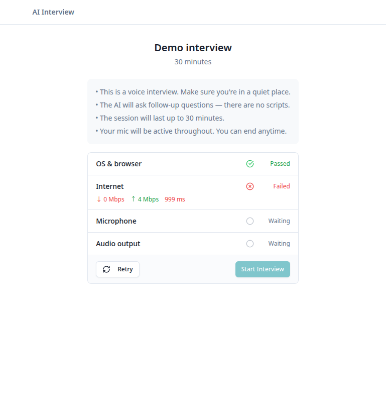
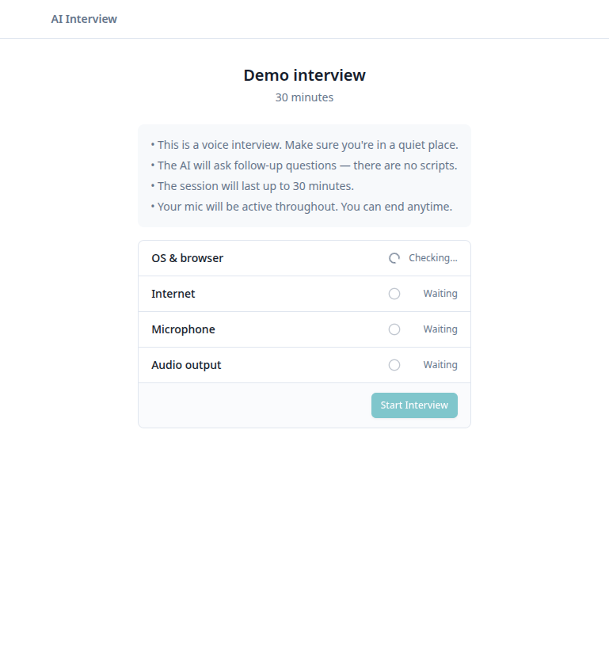
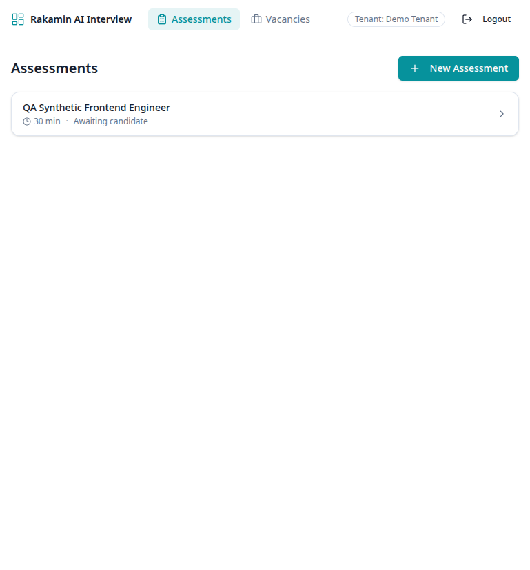
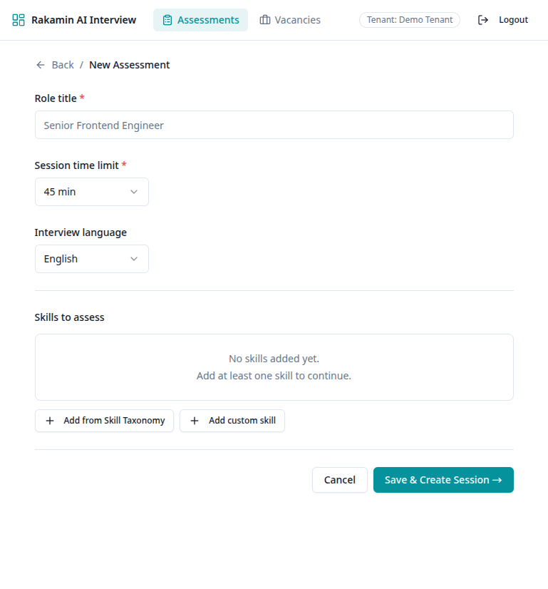
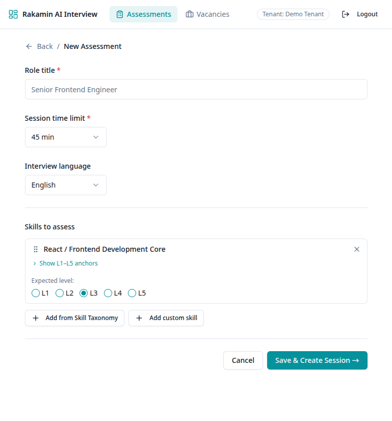

# Full Stack Assessment Case Study (AI Assisted)

**Project:** AI Interview Platform 
**Assessment date:** 27 October 2026 
**Review type:** Runtime check, PRD check, and engineering quality review 
**Product references:** [PRD 01: First Principles (AI Interview Behavior)](https://github.com/rakamindev/ai-interview-platform/wiki) and [PRD 02: Real Simulation (End-to-End Interview)](https://github.com/rakamindev/ai-interview-platform/wiki) 
**Assignment reference:** The *Fullstack Product Engineer* case-study brief I was given

## Executive summary

The API responds to health checks and the web app builds. A handful of assessor screens and API workflows also passed earlier checks using test data. That shows the services can run, but it does not show the product can complete the interview described in the PRDs.

The clearest bug a user would hit is in the candidate hardware check. When a candidate clicks Retry, the checks get stuck and Start Interview stays disabled. I reproduced this. The internet check also leans on outside test hosts, and those failed in this environment. Reading the source, I spotted two more concerns. The microphone may not get cleaned up, and an old WebSocket disconnect callback may fire late. I haven’t seen either one happen.

The biggest gap is the AI interview itself. I never ran a real Gemini interview. So I can’t say that follow-up probing, coverage tracking, the portfolio, fit/gap results, export, or reconnect work. The repo also has no test suite anyone can rely on. Rails reports zero tests, and RSpec crashes before it finds any.

**Overall conclusion:** The runtime and build checks look good. But end-to-end readiness isn’t shown. The next milestone should be a repeatable test journey with made-up data, from assessor setup all the way to interview results. It should run on tests that don’t need paid AI access, a real microphone, or outside network probes.

## What this assessment covers

This report pulls together the runtime checks and screenshots I already had, the app screens and API routes that exist, both PRDs, and the case-study brief. It’s an engineering quality review. It isn’t a security certification, a legal opinion, or the final PDF for the hiring submission.

### User and product context

The product is for assessors and recruiters who need solid evidence about a candidate’s skills. It’s also for hiring managers who have to decide based on that evidence. Candidates feel the effects too, even though they often don’t choose the tool. A wrong or weakly backed rating can cost someone a real opportunity.

So a useful result has to be more than a level from an AI. It should point back to what the candidate actually said. A human reviewer should be able to follow it. And it should be upfront about what it doesn’t know.

Candidate audio, transcripts, results, and exports need care too. That means a clear purpose for the data, access controls, retention rules, and honest notice to the candidate. The brief says to consider Indonesia’s Personal Data Protection Law (UU PDP). The suggestions below are product and engineering safeguards. They aren’t legal advice, and they don’t say whether the product complies.

### Method and limits

- I read both PRDs and the brief. Then I compared their workflows with the routes in the app and with the smoke-test results I already had.
- I checked the local API health endpoints and ran the web production build.
- I reused earlier smoke checks that ran on test data. They covered sign-in, skill lookup, assessment and session routes, and vacancy create, read, update, and delete. I removed the temporary test records afterward.
- I reviewed the candidate preflight and WebSocket findings by reading the source code.
- I used existing screenshots as evidence for the candidate preflight and assessor setup screens.
- I did a limited security review. It found no confirmed vulnerability. But I didn’t try real exploit payloads, and I didn’t test every authorization boundary or API input.
- My last browser automation run used a made-up candidate response. The test environment blocked microphone permission, and its internet check didn’t finish in time. That’s a limit of the test setup. It doesn’t prove every candidate device will fail.
- I never printed a Gemini API key or sent one to Google. Earlier Gemini checks used local stubs only. So I haven’t confirmed real provider access, free-tier quota, billing status, or live audio behavior.

## Runtime check

| Area | Result | What it shows, and what it doesn’t |
|---|---|---|
| Rails API | **Responding** | `/health` and `/api/v1/health` returned HTTP 200. That only shows the API is alive. It doesn’t prove every business workflow works. |
| PostgreSQL, Redis, Sidekiq | **Confirmed connected earlier** | In the earlier setup pass, I confirmed a local database query, a Redis ping, and one Sidekiq process. |
| Web application | **Build passed** | `npm run build` in `web/` passed the TypeScript check and the Vite production build. |
| Assessor screens | **Some screens passed** | Login, the assessment list, the new-assessment form, and the skill picker loaded in earlier checks with test data. |
| Candidate preflight | **Not reliable in this run** | Outside test requests failed in the earlier browser run, and Retry left the checks waiting. |
| Full live interview | **Not verified** | I didn’t run a real Gemini Live session, and I didn’t finish an interview with a microphone. |
| Automated tests | **Can’t catch regressions** | Rails ran zero tests. RSpec failed while loading `spec_helper`. The web package has no test script. |

### Commands and what happened

- `GET /health`: **HTTP 200**, `{"status":"ok"}`.
- `GET /api/v1/health`: **HTTP 200**, `{"status":"ok"}`.
- `npm run build` from `web/`: **passed**, including the TypeScript check.
- `bundle exec rails test` from `api/`: **0 runs, 0 assertions, 0 failures, 0 errors**.
- `bundle exec rspec` from `api/`: **failed before running any examples** with `LoadError: cannot load such file -- spec_helper`.
- Earlier smoke tests: test admin login, skill lookup (22 seeded skills), assessment and session API checks, and vacancy create, read, update, and delete. All **passed on the paths I tried**. I removed the temporary test data afterward.

## PRD alignment: today’s product against the PRDs

I kept these statuses cautious on purpose. “Code is there” means a route, screen, or service exists. It doesn’t mean the behavior passed a test.

### PRD 01: First Principles (AI Interview Behavior)

| What the PRD expects | What I found | Status |
|---|---|---|
| The interviewer reacts to what the candidate actually said and asks relevant follow-ups. It doesn’t just read a fixed list of questions. | The PRD describes this and gives examples. I had no live interview to check whether the model does it. | **Unverified** |
| It probes vague claims, pushes back on strong claims only as hard as they call for, and looks into useful skills that come up off the agenda. | These are core PRD behaviors. I had no real-time model session or transcript to look at. | **Unverified** |
| It keeps questions short, moves between topics naturally, skips empty praise, and wraps up at the right time. | The PRD includes prompt guidance. I didn’t test what the model actually says. | **Unverified** |
| It tracks coverage states and requires enough probing before it marks a skill covered. | Coverage routes and services exist. But I didn’t run the live sequence or the state changes. | **Code is there; behavior unverified** |
| It builds a portfolio from the candidate’s evidence, rubric anchors, confidence, and coverage. | Portfolio routes and generation code exist. There was no finished interview or generated portfolio, so I couldn’t check the evidence quality or the ratings. | **Code is there; output unverified** |
| It avoids the failure modes the PRD lists, like skipping follow-ups or ending before skills are covered. | I ran no realistic interview, and there’s no automated way to check the model’s behavior. | **Unverified** |

**PRD 01 conclusion:** The PRD describes the behavior it wants in detail. But I can’t confirm the running AI does any of it. The earlier checks used stubs in place of Gemini. They only show that the app handles requests and responses locally. They say nothing about interview quality, model availability, or whether the scoring is valid.

### PRD 02: Real Simulation (End-to-End Interview)

| Stage of the simulation | What I found | Status |
|---|---|---|
| The assessor signs in, sets the role, time, and skills, and creates an invite. | Login, the assessment list, the form, and the skill picker loaded with test data. I tried some setup and API actions. But I didn’t complete the full path from the UI to an invite, and I didn’t run the Gemini prompt generation end to end. | **Partially verified** |
| The candidate opens the invite and sees the right role and session details. | The candidate-info lookup passed in an earlier local API smoke test. The final browser page used a made-up candidate response, not a real saved invitation. | **Partially verified** |
| The candidate allows the microphone and starts the interview. | The browser automation environment blocked microphone access, so I never got to the start of the interview. | **Not verified** |
| Gemini Live opens and the session goes active. | I never started a real provider session. | **Not verified** |
| Interview turns are saved, and follow-ups and coverage update as the interview goes on. | There was no live interview, transcript, or coverage timeline. | **Not verified** |
| The session ends naturally or when the candidate stops it, and that kicks off portfolio generation. | I had no finished live session. | **Not verified** |
| The assessor reviews skill levels and the evidence behind them. | There was no generated portfolio to review. | **Not verified** |
| Fit/gap compares the portfolio with a vacancy and gives a useful write-up. | Vacancy create, read, update, and delete passed in smoke testing, and fit/gap routes exist. But no real portfolio-to-vacancy result was generated. | **Code is there; end-to-end behavior unverified** |
| Export produces a usable result document. | The export route exists. There was no generated result to export or look at. | **Code is there; output unverified** |
| A Gemini reconnect picks up the conversation without losing state. | I didn’t run a controlled Live API reconnect test. A separate concern about a browser-disconnect race, found in the source, is listed below. | **Not verified** |

**PRD 02 conclusion:** The assessor setup and a few API routes are the best-verified parts. The journey from candidate to results is the core promise of the product. And it’s still unproven.

## Findings and severity

I set severity by how badly a user is hurt and how likely it is in the workflow I tested. I confirmed no P0. If a finding says “source-reviewed” or “unverified,” I’m not claiming I saw it happen.

### P1: Retry can leave a candidate unable to start

**Service:** Web
**Type:** Code bug; reproduced
**Impact:** A candidate hits a failure they could recover from. Then Retry leaves the checks stuck on “Checking” or “Waiting,” and Start Interview stays disabled.

So here’s what happened. The browser showed an Internet failure. After Retry, the OS/browser check stayed on “Checking...” and the Internet check stayed on “Waiting.” They never settled. In [`HardwareCheck.tsx`](../web/src/components/HardwareCheck.tsx), Retry resets the statuses. But at least one check starts from an effect that only runs on mount. Resetting the status doesn’t run that effect again. So that check never restarts.

**Recommended fix:** Treat each preflight attempt as its own thing. On Retry, restart every check. Cancel or ignore results from the previous attempt. Then add a browser test that fails before the fix and passes after it.

### P1: Outside network probes can block a candidate

**Service:** Web
**Type:** Blocker in this environment, plus a weak spot in the product. I saw it fail here.
**Impact:** If the third-party CDN or echo hosts the code uses can’t be reached, a candidate can be blocked even when the app’s own API is fine. Picture a candidate on a good connection whose network blocks those hosts. They could still get stuck.

[`internetSpeedTest.ts`](../web/src/utils/internetSpeedTest.ts) hard-codes third-party download sources and uses default upload hosts. In the earlier browser run, those requests failed, and the check returned failing values. That shows the app depends on those hosts, and that they failed here. It doesn’t show that every production network has the problem.

**Recommended fix:** Use a probe the team owns, or one that can be configured. Decide what happens when a measurement isn’t available. Tell an unreachable test host apart from a connection that’s truly too slow. And don’t let a nice-to-have outside measurement be the only gate to starting.

### P2: Microphone and audio-monitoring cleanup needs checking

**Service:** Web
**Type:** Concern from reading the source (resources and privacy); not reproduced
**Impact:** A mic-only stream may stay open after a retry or after the component goes away. And the audio-level animation loop may keep running after its component is gone.

The cleanup code in [`HardwareCheck.tsx`](../web/src/components/HardwareCheck.tsx) stops the tracks held in the video stream state. But it doesn’t clearly keep the mic-only stream around so it can be stopped later. The animation loop calls `requestAnimationFrame` and has no way to cancel it. The browser couldn’t grant microphone permission, so I never saw real device cleanup.

**Recommended fix:** Keep a handle on every media track the code opens. Stop each one on retry, on completion, and on unmount. Cancel the animation frames and close the audio contexts. Test it with a fake media stream and a controlled animation-frame scheduler.

### P2: An old WebSocket disconnect action may hit a reconnected session

**Service:** API
**Type:** Possible race from reading the source; not reproduced
**Impact:** Say a candidate reconnects during the grace period. A delayed action from the earlier disconnect could still fire and act on a session that’s live again.

The disconnect flow I reviewed is in [`audio_websocket_middleware.rb`](../api/app/channels/audio_websocket_middleware.rb). I didn’t run a controlled timer and reconnect test. So this is a risk to check. It’s not a confirmed bug where a session gets ended by mistake.

**Recommended fix:** Cancel the old timer, or guard it with a token that marks which disconnect it belongs to. Before ending the session, check two things: the browser is still disconnected, and the callback belongs to the current disconnect. Then test both cases with a fake clock. One is a reconnect before the timer runs out. The other is a timer that runs out with no reconnect.

### P2: The automated tests can’t protect the workflow right now

**Services:** API and web
**Type:** No working safety net
**Impact:** CI has no reliable check that would catch the Retry bug, or the cleanup and reconnect risks, if they came back.

Rails finds zero tests. RSpec fails when it loads `spec_helper`. The web package has build and dev scripts but no test command. A passing build doesn’t replace workflow tests.

**Recommended fix:** Get working test runners for both the API and the web app. Make CI fail when it finds zero tests. Cover the candidate flow, session handling, and the failure paths with fixed, repeatable test data.

### P3: Candidate transparency and assessor review need clear product requirements

**Services:** API and web
**Type:** Gap in the product and privacy requirements; not a bug I proved in the running workflow
**Impact:** If nobody decides how candidates get notice, how evidence is reviewed, how mistakes are corrected, and how long data is kept, teams may treat an AI rating as a full hiring decision. Neither the candidate nor the assessor would have enough context.

The brief asks the team to think about candidates who never chose this product, and to consider UU PDP. The PRDs focus on how the interview behaves and what it produces. I didn’t find a tested, end-to-end experience for candidate transparency, rating review, correction requests, or data retention. That’s a gap in the spec and in testing. I’m not saying the app breaks the law.

**Recommended next step:** Before any real candidate data goes in, sit down with product, privacy, and legal people. Decide what the candidate is told. Decide who can see the data and how long it’s kept. Decide who is accountable on the assessor side. And decide how a rating gets reviewed or corrected.

### Security review

The limited security review found **no confirmed vulnerability**. It wasn’t a full audit yet, some areas still need repeatable tests such as authentication and authorization on the result and export routes, invite-token handling, input validation, dependency risk, and how candidate data is stored, logged, and kept. These are the recommended places to test and aren’t reported vulnerabilities.

## Case-study brief alignment

The brief asks for a product-engineering submission, not just an app that runs. Here’s what this report covers and what it doesn’t.

| Brief step or deliverable | Status in this assessment |
|---|---|
| Run and explore both services | **Done, as far as recorded above.** I checked API health, the connections to PostgreSQL, Redis, and Sidekiq, the web build, some assessor screens, and the API smoke checks. |
| Understand users and candidate impact | **Partly covered.** The report names assessors, recruiters, hiring managers, and candidates, and says why evidence quality and privacy matter. I didn’t do independent research on hiring in Indonesia. And there was no legal review under UU PDP. |
| Rank gaps from P0 to P3 and separate missing definition from broken behavior | **Covered for the findings here.** Retry is a bug I reproduced. The reliance on outside probes is a problem I saw in this environment, and also a design gap. Media cleanup and reconnect are concerns from reading the source. The test setup is missing. I confirmed no P0. |
| Propose a full-stack revamp with acceptance criteria and trade-offs | **Covered as a proposal below.** I didn’t build any fix or new feature as part of this report update. |
| Prove tests fail before a fix and pass afterward | **Not done.** I didn’t run an experiment where I plant a fault on purpose. |
| Show migration safety, failure handling, and automated implementation tests | **Not shown by this review.** The API has no real tests that could back those claims up. |
| Document an AI-generated suggestion that was risky or wrong, and how it was corrected | **Not fully met.** I checked earlier model defaults with local stubs. But that isn’t the AI-verification moment the brief asks for, and I’m not claiming it is. |
| Provide a pull-request link and a 3 to 5 minute walkthrough video | **Not included.** This report doesn’t create a PR or a video, and it doesn’t claim to. |
| Provide visual evidence | **Partly covered.** The screenshots show the candidate preflight failure and retry, and the assessor setup. They don’t show a complete or redesigned interview and results flow. |
| Submit a single PDF | **Not produced.** What I was asked for here is the Markdown report. Turn it into a PDF only if the final submission portal needs one. |

### What a technical lead should know

- **Provider behavior is unknown:** I sent no real Gemini request. Model and API compatibility, free-tier quota, rate limits, and live audio behavior all still need a smoke test that someone approves separately.
- **The core journey has no test protection:** Rails finds no tests, and RSpec can’t load its helper. A passing build or a healthy health check doesn’t show the product is right.
- **Candidate devices are barely tested:** The browser automation environment denied microphone permission, and outside speed-test services failed in the earlier run. The team needs a controlled device and media test, plus a clear fallback rule.
- **Someone has to own privacy:** Before real candidate data is used in production, the team needs a written decision on notice, purpose, access, and retention and deletion. People qualified to judge UU PDP should review it.

## Evidence

The assessor screenshots show test assessment data. They prove what was on the screen. They don’t prove the full end-to-end workflow passed.

1. [Candidate internet check failed](./evidence/candidate-internet-check-failed.png)
   
2. [Retry leaves checks waiting](./evidence/candidate-retry-stuck.png)
   
3. [Assessor assessment list](./evidence/assessor-assessment-list.png)
   
4. [New assessment form](./evidence/assessment-form-loaded.png)
   
5. [Assessment skill selection](./evidence/assessment-skill-form.png)
   

The microphone cleanup and WebSocket reconnect concerns need controlled automated tests. A screenshot can’t prove timing problems or leaked resources.

## Proposed revamp: reliable interview results backed by evidence

Here’s the thing. The best first step isn’t another AI feature. Fix the candidate journey so a candidate can recover when something goes wrong. Then make sure every result an assessor sees can be traced to evidence, can be reviewed, and says what it doesn’t know.

### Options and trade-offs

| Option | What it delivers | Cost and upkeep | Risks and trade-offs |
|---|---|---|---|
| **A. Patch only the browser checks** | Quick fixes for Retry and mic cleanup. Very little backend change. | Cheapest to start. Easy to maintain. | Leaves the outside probe dependence and the session-handling races alone. Fixes the symptoms without checking the whole journey. |
| **B. Build a reliable preflight and session slice** | A clear state for each preflight attempt, controlled probe behavior, media cleanup, session state that survives a reconnect, and tests across web and API. | Medium effort across both services. Leaves clean places to build on later. | Needs careful coordination between client and server state, and stable fakes for outside services. A bit more design up front. |
| **C. Build a bigger AI scoring and assessor decision platform first** | Adds rubric versions, portfolio review, overrides, and richer fit/gap workflows. | Most expensive. Touches the data model, prompts, UI, and permissions. | Could magnify interview and evidence problems nobody has checked yet. Costly to change if the live journey underneath turns out to be unreliable. |

**Recommendation:** Go with Option B first. It fixes a problem candidates actually hit. It makes the data that later AI analysis relies on more reliable. And it gives you pieces you can test. Once a repeatable test interview passes, follow up with the evidence-based review features from Option C.

### Acceptance criteria for the first revamp

1. **Retry:** Every check starts fresh on each attempt. Late responses from an earlier attempt can’t overwrite the newest result.
2. **Network measurement:** If a probe is blocked or times out, the app says “could not measure.” It doesn’t quietly treat that as a measured zero. The product policy says whether that case blocks the interview from starting.
3. **Microphone:** Permission denied, no device, unsupported browser, and device already in use each show a different message. Each message tells the candidate what to do next.
4. **Cleanup:** On retry, on completion, on navigation, and on unmount, every audio track is stopped, every animation frame is cancelled, and every audio context is closed.
5. **Session start:** Sending the start request twice doesn’t create two active sessions or two jobs. For an invitation that already started or has expired, the API returns a clear state.
6. **Reconnect:** If the candidate reconnects before the grace period ends, the session stays active. If the grace period ends with no reconnect, the session ends once. An old timer can’t end a newer connection.
7. **Coverage:** A skill can’t be marked covered unless it hit the PRD’s minimum probe count and has evidence you could defend. If the analyzer call fails, the last known coverage map stays. It doesn’t vanish without a word.
8. **Portfolio:** Every rating has evidence that came from the candidate, plus a confidence level. There’s also a clear “insufficient evidence” state. A missing rating is never turned into a zero or into a nice-looking default.
9. **Human review:** Assessors can look at the evidence and correct a rating, and they write down why. The AI score is never shown as a final hiring decision nobody can question.
10. **Failure handling:** A Gemini timeout, a quota denial, malformed JSON, a partial transcript, or a background job delivered twice all leave a visible state that can be recovered. None of them produce an empty report that looks like a success.
11. **Long content and odd inputs:** Long transcripts, empty strings, missing skill anchors, unexpected rating values, and Unicode or Indonesian text are all checked and shown properly. Nothing gets cut off in a way that changes the meaning, and nothing overflows the UI.
12. **Data protection:** Logs and test data hold no real candidate data and no secrets. Only authorized people can reach transcripts, portfolios, and exports. Retention and deletion rules are written down before production use.

## Future enhancements

These ideas come from the PRDs and the case-study brief. They’re proposals. They aren’t claims about what the product does today, and they aren’t legal requirements.

### 1. Candidate trust and accessibility

- Add a clear notice before the interview. Say what gets recorded, why, who can see the results, and how long the data is kept.
- Give plain microphone and network diagnostics, with tips for fixing problems. Add another way forward for when device permissions or network measurement aren’t available.
- Offer Indonesian and English for both the UI and the interview. Make keyboard and screen-reader use work. Make layouts fit different screens. And make reasonable accommodations for candidates with different devices or communication needs.
- Set up a proper way for candidates to ask questions, ask for corrections, or make data-rights requests. Have legal and operations review it before launch.

### 2. Evidence-based assessor review

- Show each skill rating with its rubric anchor, quotes from the candidate, confidence, probe count, and any evidence that’s missing.
- Let an assessor accept or change an AI suggestion, with a short reason and a history of who changed what.
- Keep three things clearly apart: what was observed, what the model read into it, and what a human decided.
- Label skills found along the way as exploratory. Don’t treat them like fully assessed skills.
- Allow a “not enough evidence” result and suggest a follow-up. Don’t force a number.

### 3. Fair and consistent assessment

- Version the rubrics and the generated prompts. That way old results still make sense after a rubric changes.
- Add calibration tools for assessors. Use shared made-up examples, and let assessors compare the reasons behind their ratings.
- Watch for results that differ in a consistent way across language, role, or candidate groups. Combine the data in a way that protects privacy, and have qualified people review it.
- Don’t guess protected or personal traits from a voice, an accent, appearance, or off-topic conversation.
- Treat automated scores as help for a decision, not the decision. A real person stays accountable.

### 4. Privacy, security, and operations

- List what data exists, and set its purpose, retention, deletion, and access rules for audio, transcripts, portfolios, and exports. Bring in someone who knows UU PDP.
- Keep a record of who accesses candidate records and exports. Strip secrets and extra personal data out of the logs.
- Use role-based access, and check authorization explicitly on the portfolio, transcript, fit/gap, override, and export endpoints.
- Add the team’s own health and readiness checks. Make queues and jobs visible. Sort provider errors into clear categories. Set up alerts for operations.
- Let background jobs retry and recover in a controlled way, without duplicate portfolios or half-finished writes.

### 5. Hiring-team workflow

- Support reviewer comments and structured follow-up questions that are tied to evidence. A single score isn’t enough.
- Compare candidates against a role rubric. Don’t rank them on signals nobody validated, or signals that don’t matter for the job.
- Let teams share assessment templates. Each template should have an owner, a version history, and clear permissions.
- Make exports accessible, tied to a rubric version, and clear about which conclusions came from the AI and which came from a person.

## Future enhancement UI concepts

The PDF appendix contains 15 screen mockups: three screens for each of the five enhancement themes above. They use the existing product’s teal-and-white palette, compact top navigation, restrained cards, and plain-language status labels as a visual starting point. The screens are proposals, not implemented product features. Any example people, records, metrics, and policy values are illustrative and should be replaced with approved product and legal requirements before implementation.

The editable mockup source is [future-enhancement-mockups.html](./mockups/future-enhancement-mockups.html).

| Enhancement | Screen concepts |
|---|---|
| **1. Candidate trust and accessibility** | 1) Plain-language interview notice, data-use summary, and candidate choice. 2) Guided microphone/browser/network checks with an explicit “could not measure” fallback. 3) Candidate privacy and support center for questions, correction requests, and data requests. |
| **2. Evidence-based assessor review** | 1) Skill review separating candidate evidence, AI interpretation, rubric anchor, and assessor decision. 2) Coverage map and follow-up for missing evidence, including an unrated “not enough evidence” state. 3) Human decision history showing reviewer rationale and provenance. |
| **3. Fair and consistent assessment** | 1) Immutable rubric versions and a draft change preview. 2) Assessor calibration using fictional examples and shared reasoning. 3) Aggregate consistency monitoring with small-group suppression and qualified review. |
| **4. Privacy, security, and operations** | 1) Data inventory, proposed retention controls, and named policy owners. 2) Role-based access matrix and an audit trail for allowed and denied access. 3) Queue and provider health with categorized, recoverable job failures and redacted diagnostics. |
| **5. Hiring-team workflow** | 1) Candidate comparison against approved role criteria without an unsupported overall ranking. 2) Shared assessment template library with owners, versions, and access. 3) Evidence-linked reviewer discussion, follow-up questions, and a versioned accessible export. |

These concepts are intended to make the recommendations tangible and help stakeholders discuss the workflow. They do not establish that the current application has the screens, controls, integrations, or safeguards shown.

### What each screen shows and why it matters

The notes below explain the intent behind every mockup. The importance is practical: each screen addresses a user need or a control gap identified in the recommendations above. None of the screens implies the feature is already implemented.

#### 1. Candidate trust and accessibility

1. **A clear, plain-language interview notice**
   - **What it shows:** Before the candidate proceeds, the notice explains what information may be collected, why it is used, which team can access it, the applicable retention policy, and where to ask questions or request an accommodation.
   - **Why it matters:** Candidates need understandable information before device checks or recording begin. An early, accessible explanation supports informed participation and reduces surprises that could undermine trust.
2. **Guided device check with a safe fallback**
   - **What it shows:** Microphone, browser, and network outcomes are separated. A failed or unavailable network probe is labeled “could not measure,” with retry guidance and a clear next step rather than a fabricated speed score.
   - **Why it matters:** Device problems should be recoverable and honestly described. Distinguishing a real failure from an unavailable measurement avoids unnecessarily blocking candidates or misrepresenting their connection.
3. **Candidate privacy and support center**
   - **What it shows:** Candidates can review information about their interview record, contact the hiring team, and find routes for questions, correction requests, and data requests.
   - **Why it matters:** Candidate trust does not end when an interview starts. A visible support route makes it practical to raise a concern or correct an inaccurate record, while keeping the employer responsible for deciding and handling the request.

#### 2. Evidence-based assessor review

4. **Skill review anchored in candidate evidence**
   - **What it shows:** A reviewer sees the candidate’s quoted response, the AI’s interpretation, the relevant rubric anchor, probe coverage, confidence, and a distinct human decision.
   - **Why it matters:** Separating evidence from interpretation makes the suggestion contestable and keeps the assessor accountable. It reduces the chance that a polished AI score is accepted without checking what the candidate actually said.
5. **Coverage map and evidence-gap follow-up**
   - **What it shows:** The screen maps probes and evidence to each skill, highlights what remains unexplored, and offers a follow-up or an explicit “not enough evidence” outcome.
   - **Why it matters:** Missing evidence is not the same as weak ability. Making the gap visible helps prevent forced ratings and gives the team a consistent way to decide whether to ask a follow-up or leave a skill unrated.
6. **Human decision history and review provenance**
   - **What it shows:** A time-ordered history records the interview and analysis, the original AI suggestion, the human reviewer’s decision and reason, linked evidence, and rubric version.
   - **Why it matters:** Results can be revisited or corrected without losing how they were reached. This is important for internal accountability, candidate questions, and exports that need a reliable review trail.

#### 3. Fair and consistent assessment

7. **Rubric versioning with a transparent change log**
   - **What it shows:** Published rubric versions remain identifiable, draft changes can be compared before review, and past sessions stay associated with the version they used.
   - **Why it matters:** Without version history, teams cannot reliably interpret older ratings or explain a changed standard. Immutable versions also help ensure that an edit intended for future interviews does not silently alter an in-progress assessment.
8. **Assessor calibration with shared practice cases**
   - **What it shows:** Assessors independently rate a fictional response against rubric anchors, write down the evidence behind their rating, and compare reasoning after submitting.
   - **Why it matters:** Calibration exposes unclear anchors and differences in interpretation before those differences affect real candidates. Synthetic examples allow practice without exposing candidate records.
9. **Aggregate fairness monitoring with privacy safeguards**
   - **What it shows:** Authorized reviewers see aggregate process indicators, minimum-group suppression, and a queue for investigating a possible issue; the screen avoids candidate-level inference or automatic ranking.
   - **Why it matters:** A team needs a cautious way to notice possible differences in process or evidence coverage. Aggregate signals are prompts for qualified investigation—not proof of bias, a finding about an individual, or a hiring decision.

#### 4. Privacy, security, and operations

10. **Data inventory and retention policy controls**
    - **What it shows:** The screen lists data categories alongside their purpose, access, proposed retention, deletion process, and policy owners, with draft status clearly marked for review.
    - **Why it matters:** Teams cannot protect data consistently if no one knows what exists, why it is held, or who owns the rules. Explicit ownership supports security and legal review before a policy is presented as approved.
11. **Role-based access and auditable record access**
    - **What it shows:** A permission matrix makes role capabilities visible, while the audit list records both allowed and denied attempts to access candidate records.
    - **Why it matters:** Least-privilege access limits unnecessary exposure of transcripts and results. An audit trail also helps teams investigate access questions and verify that authorization controls behave as intended.
12. **Queue health and recoverable provider failures**
    - **What it shows:** Operators can see queue state, provider status, retryable job failures, attempt counts, and safe diagnostics that do not reveal candidate content or credentials.
    - **Why it matters:** Background failures should be diagnosable and recoverable without producing a success-shaped empty report or duplicate results. Clear operational states help teams respond while protecting sensitive information.

#### 5. Hiring-team workflow

13. **Candidate comparison against role requirements**
    - **What it shows:** Several candidates’ reviewed evidence is compared against the same approved role criteria, with missing evidence and follow-ups visible and no synthetic overall ranking.
    - **Why it matters:** Hiring teams need to discuss relevant evidence consistently, but a single combined score can conceal different evidence quality or unvalidated signals. A criteria-based view supports discussion without pretending the application can make the hiring decision.
14. **Shared assessment templates with ownership and versions**
    - **What it shows:** A team library identifies each template’s owner, version, status, included skills, and who can use or edit it.
    - **Why it matters:** Reuse can save setup time and improve consistency, but only if teams know who maintains a template and which version was used. Access controls and versioning reduce the risk of silent changes to an assessment already in use.
15. **Evidence-linked reviewer discussion and accessible export**
    - **What it shows:** Reviewer comments and follow-up questions stay attached to the relevant evidence. The export preview labels AI suggestions separately from human decisions and includes the rubric version and review history.
    - **Why it matters:** Discussion tied to source evidence is easier to verify than comments detached from context. A clear, accessible, versioned export helps downstream readers understand what the model suggested, what a person decided, and why.

## Phased delivery plan

### Phase 1: Make the tests something you can trust

- Fix the API test setup, or switch to a runner that’s clearly supported. Add a check that fails when no tests are found.
- Add a web test runner and repeatable browser tests for the candidate preflight.
- Keep test data separate from the development seed data. Keep normal CI free of live Gemini, real microphones, email, and outside CDNs.

**Exit check:** CI runs real API and web tests, and it fails when it can’t find them.

### Phase 2: Steady candidate entry and session handling

- Fix how Retry attempts run, how the network probe behaves, media cleanup, and how old reconnect timers get cancelled.
- Add WebSocket tests with a fake clock. Add fake media streams, timeout tests, and permission-denied tests.
- Check how the API handles an expired invite, a duplicate start, a repeated end, and an interrupted session.

**Exit check:** A test candidate can recover from a preflight failure, start once, reconnect safely, and leave no microphone resources running after exit.

### Phase 3: Check interview behavior without paid AI

- Use a fake Gemini adapter and canned transcripts. Test the prompt setup, transcript saving, coverage changes, minimum probing, and the conditions that end a session.
- Add scenario checks for vague answers, strong answers, off-agenda finds, short answers, silence, and model errors.
- Confirm the results never give a skill level the evidence doesn’t support.

**Exit check:** The PRD’s interview rules are covered by repeatable automated tests before anyone judges real model behavior.

### Phase 4: Build the evidence-based portfolio and human review

- Add versioning for rubrics and prompts. Add evidence and confidence fields to the portfolio.
- Add assessor review, rating overrides with a reason, and handling for “insufficient evidence.”
- Test portfolio generation failures, duplicate jobs, partial outputs, and long transcripts.

**Exit check:** Every rating on screen traces back to evidence and a rubric version. An assessor can correct it without losing the history.

### Phase 5: Run the full PRD simulation and a controlled provider check

- Run assessor setup, invite, candidate preflight, live interview, coverage, portfolio generation, fit/gap, and export, all with test data.
- Add provider smoke checks that people choose to run. They should hide secrets, respect the quota, and stay separate from CI.
- Use a short test session to check current model and API compatibility, timeout and quota behavior, and reconnecting and resuming.
- Record screenshots and a walkthrough of a success path and of a real failure being recovered.

**Exit check:** The whole PRD scenario passes with test data. Any claim about the live provider is backed by a separate, safe smoke test that was recorded.

### Phase 6: Get ready for real candidates

- Review privacy, retention, access, accommodations, and what candidates are told with the right legal and domain experts.
- Run systematic authorization and input validation tests across the candidate and assessor APIs.
- Set up monitoring, incident response, backup and restore, migration rollback, and release readiness checks.

**Exit check:** Product, engineering, and privacy people agree on the operating controls before any real candidate data goes in.

## Final assessment

The project runs well enough to build and to answer health checks. I also tried a few assessor and API paths. But I can’t say yet that the product works end to end against the PRDs. The candidate Retry bug is reproduced. Several AI, reconnect, result, and export behaviors are still unverified. And there’s no automated suite to close those gaps of the feature.

The right next step is a small testable slice that makes the full stack more reliable. First, make candidate entry recoverable. Next, make session handling safe. Then prove the full test interview and the evidence-based review flow. That gives assessors a tool they can depend on. And it gives candidates a fairer experience they can understand.